# Service flow & module relations

Sơ đồ tổng hợp flow và quan hệ giữa các service/module trong `gas-store-app`: backend (FastAPI), web (React/Vite), mobile (Expo, offline-first) và hạ tầng deploy.

Ghi chú quan trọng:

- **Backend không có repository layer.** Router và service truy vấn ORM trực tiếp qua `Session`. `backend/app/api/routes.py` (~2.979 dòng) chứa luôn các helper công nợ và audit.
- **Chỉ đường web `POST /api/orders` ghi sổ công nợ.** Đơn tạo qua mobile `POST /api/sync/push` không tạo dòng `debt_ledger_entries`.
- **Code thừa:** `QueryClientProvider` (TanStack Query) không được trang nào dùng; `wrangler.jsonc` không được script/workflow nào dùng; `services/note_parser.py` không có caller.
- **Export chỉ có CSV (UTF-8 BOM) và HTML**, không có xlsx/docx phía server. "Dashboard feature gate" chỉ là checklist trong `docs/dashboard-feature-gate.md`.

## 1. Kiến trúc hệ thống & deploy

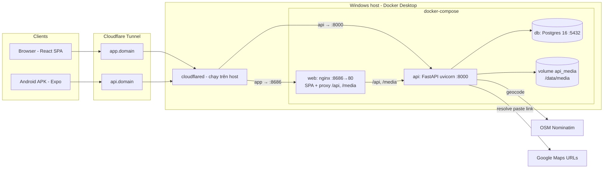

- Dev: Vite `:5173` proxy `/api`, `/media` → `127.0.0.1:8000`; emulator gọi `10.0.2.2:8000`.
- Khởi động trên Windows: `scripts/start-gas-store.bat` → `scripts/start-manual.ps1` (đợi Docker → `docker compose up -d --build` → chạy `cloudflared` với `CLOUDFLARE_TUNNEL_TOKEN`). Phương án thay thế: Task Scheduler `GasStore-Production` → `scripts/start-production-windows.ps1`.

## 2. Backend: router → service → model

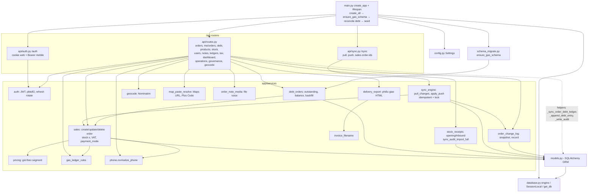

### Bảng router → service

| Nhóm API | Endpoint chính | Service / model |
|---|---|---|
| Auth | `/auth/login`, `/refresh`, `/logout`, `/mobile/*`, `/me` | `services/auth`, `User`, `RefreshToken` |
| Sync | `/sync/pull`, `/sync/push`, `/sync/sales-order-ids` | `sync_engine` → `sales`, `order_change_log` |
| Orders | `/orders` CRUD, `/orders/{id}/change-log` | `sales`, `order_change_log`, `debt_orders` + debt helpers |
| Staff orders | `/me/orders`, `PATCH /me/orders/{id}` | `SalesOrder`, `sales.order_to_response` |
| Debt | `/debt-orders`, `/debt-accounts`, `/debt-payments`, `/debt-write-offs`, `/debt-aging` | `debt_orders`, `phone`, `Debt*` |
| Catalog / stock | `/products`, `/products/{id}/stock-receipts`, `/stock-receipts`, `/cylinder-templates` | `stock_receipts`, `Product`, `CylinderTemplate` |
| Ledgers / export | `/gas-ledger[.csv]`, `/shell-debt-ledger[.csv]`, `/sales-gas-export.csv`, `/orders/{id}/delivery-slip.html` | `gas_ledger_rules`, `delivery_export`, `invoice_filename` |
| Tax | `/orders/tax-report`, `/tax-export.csv` | `SalesOrder` + lines |
| Dashboard | `/dashboard`, `/dashboard/summary?range=` | aggregate trong `routes.py` |
| Operations | `/operations/delivery-day-summary`, `/operations/daily-cylinder-audit[/{date}]` | `DailyCylinderAudit`, `stock_receipts` |
| Notes | `/order-notes`, `/order-notes/voice` | `OrderNote`, `order_note_media` → `/media` |
| Geocode | `/geocode`, `/geocode/reverse`, `/geocode/from-paste` | `geocode`, `map_paste_resolve` |
| Governance | `/shift-settlements`, `/finance-kpis`, `/complaint-tickets`, `/capa-items`, `/audit-logs`, ... | model tương ứng + `_write_audit` |

## 3. Data model (rút gọn)

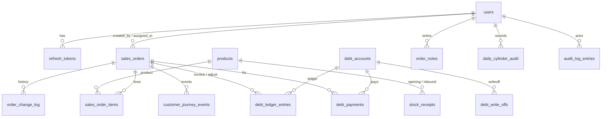

- `debt_accounts.customer_key` là số điện thoại đã chuẩn hoá (`phone.normalize_phone`).
- `order_notes` không có FK trỏ tới đơn hàng.
- `sync_applied_mutations` là bảng độc lập, dùng để chống ghi trùng khi push.
- Chi tiết ER từng domain: `docs/database/relations-postgresql.md`.

## 4. Frontend web: module/component

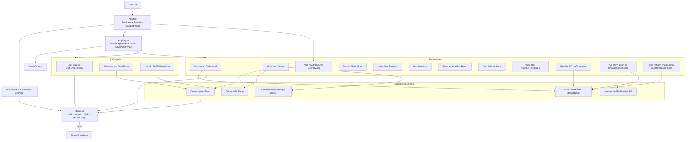

- Public: `/` `StoreLanding` (tĩnh), `/admin` `Login`.
- State toàn cục duy nhất là `AuthContext`; mọi trang tự fetch bằng `useState` + `useEffect` + `apiGet/apiPost`.
- `DeliverySlip` và `Login` không dùng `AppLayout`.

## 5. Mobile: module + offline sync

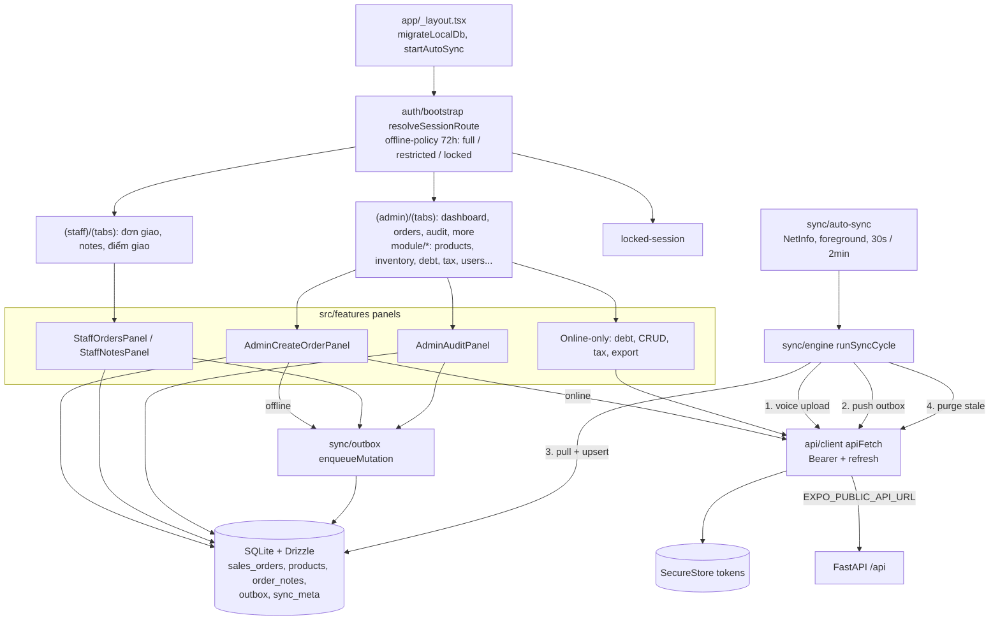

## 6. Flow nghiệp vụ chính

### 6.1 Đăng nhập: web (cookie) vs mobile (Bearer)

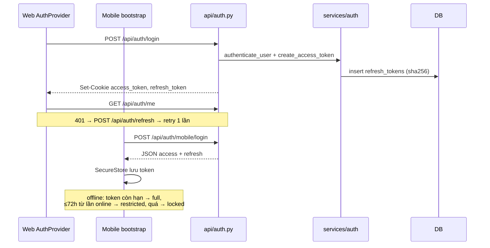

### 6.2 Tạo / sửa / xoá đơn trên web + công nợ

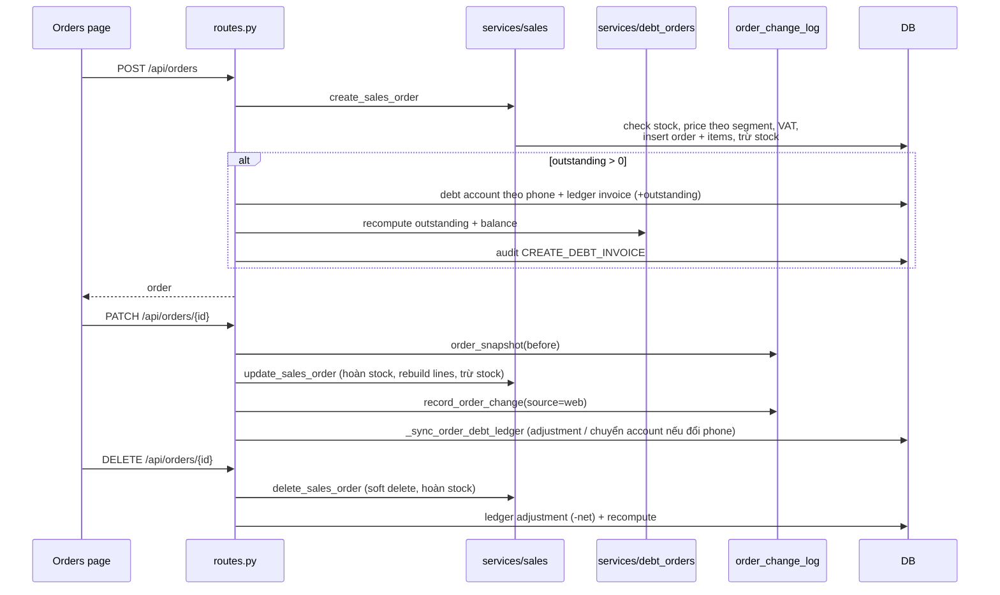

### 6.3 Thu nợ / xoá nợ

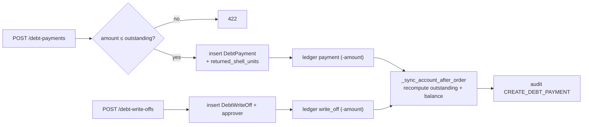

### 6.4 Mobile offline sync (push → pull)

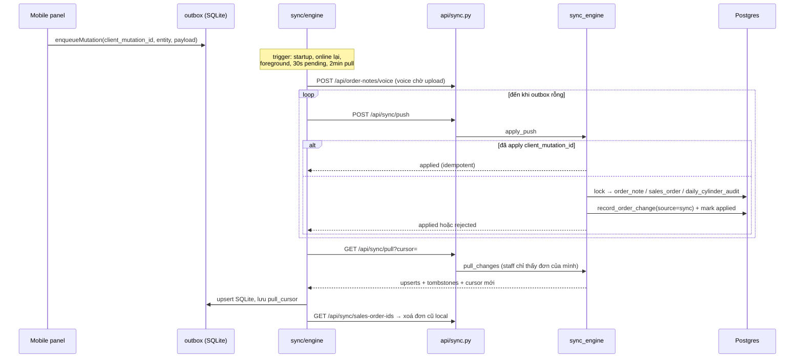

Đơn tạo qua sync **không** ghi `debt_ledger_entries`.

### 6.5 Kho & kiểm kê bình

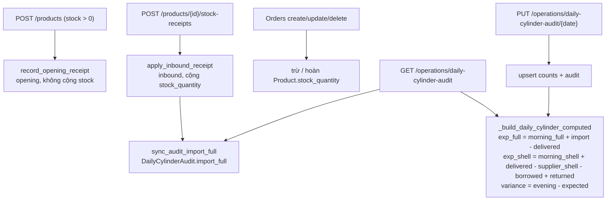

### 6.6 Geocode địa chỉ giao hàng

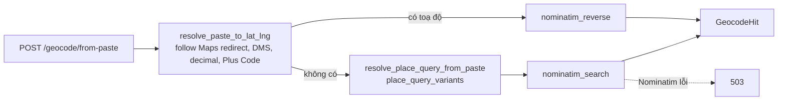

## 7. CI / release

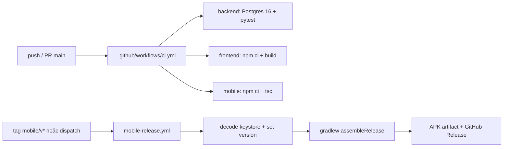
